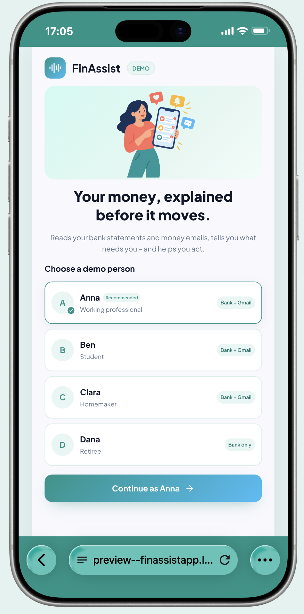
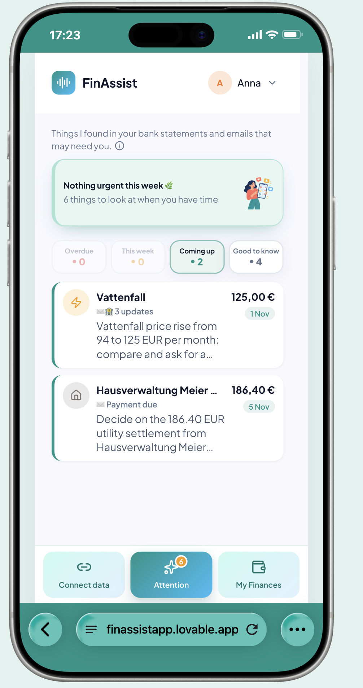
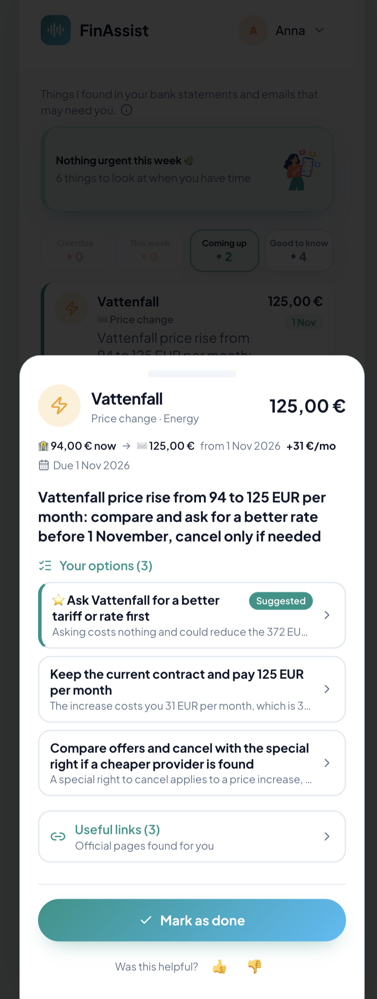
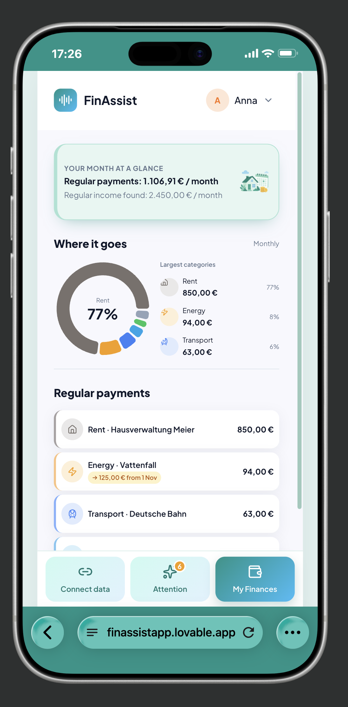
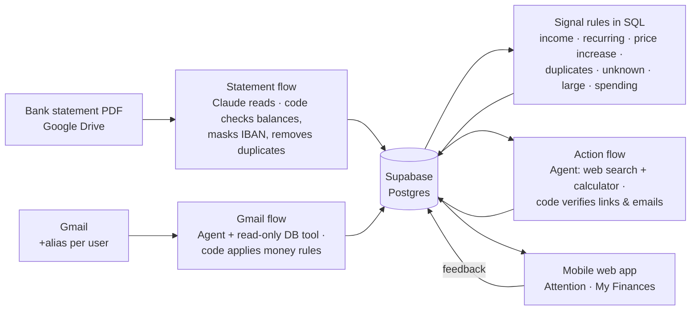

# FinAssist

**Know what's coming. Know what to do.**

FinAssist is an AI money assistant for people in Germany. It reads your bank statements and the money-related emails you receive, tells you what needs your attention, and helps you act on it with clear options, a ready-to-send German email and verified links. It never moves money.

> 📱 **Try the app:** [finassistapp.lovable.app](https://finassistapp.lovable.app) (made-up demo data, pick a person to start).

| Choose a person | What needs you | Options and next steps | Your month at a glance |
|:---:|:---:|:---:|:---:|
|  |  |  |  |

More screens: [connect data (simulated)](docs/screenshots/2_connect_data.png) · [all set](docs/screenshots/3_all_set.png)

---

## The opportunity

With the customer's consent, a person's most reliable financial signals are now within reach. Through **open banking (PSD2)**, licensed providers can read bank transactions, the authentic record of how money actually moves. The proposed EU **Financial Data Access regulation (FiDA)** aims to extend this to savings, investments and insurance. The inbox, which the person can connect with their own consent, is where the future arrives first: price changes, bills, deadlines and refunds.

Most finance apps use this data to look **backwards**: categories, trends and charts. FinAssist goes one step further. It **combines what already happened with what is about to happen**, and it doesn't stop at an insight: it tells the person **what to do next** and prepares it.

| Typical finance app | FinAssist |
|---|---|
| "You spent 18% more on energy" | "Your electricity rises to 125 € on 1 Nov. You may cancel under your *Sonderkündigungsrecht*: here are 3 options and a ready German email." |
| Past transactions only | Past transactions **+** upcoming events from email |
| Insights | Insights **+** a decision **+** the next step |

**Why it matters:** money surprises rarely come out of nowhere, but the warning signs sit in two places nobody reads together. In Germany this comes with extra friction: German-language letters, *Sonderkündigungsrecht* (special right to cancel after a price increase), SEPA direct-debit returns and formal cancellation emails. People notice too late, or know what to do but never write the email.

**This MVP is built to plug into that ecosystem.** Today it reads uploaded statements and forwarded emails. In production, the same pipeline would take transactions from an open-banking provider, with nothing else changing downstream: the statement flow already ends in the same transactions table a bank connection would fill.

## Landscape in Germany

Money-management apps read bank transactions to detect contracts, send alerts and offer cancellation; banks' own apps add spending insights; separate services handle cancellation letters, and comparison sites help people switch provider. All of them start from **past transactions** or a decision the person has already made. None reads the **inbox** to catch what is coming, and none prepares the next step for the person. FinAssist fills that gap.

## Who it is for

Four demo personas, chosen because their money lives look different:

| Persona | Data | What FinAssist finds for them |
|---|---|---|
| **Anna**, working professional | Bank + Gmail | Electricity price rise, two streaming services, a trial turning paid, an overdue school-trip payment |
| **Ben**, student | Bank + Gmail | Semester fee due, Spotify price rise, overlapping subscriptions |
| **Clara**, homemaker | Bank + Gmail | Kita fee increase, a refund-or-voucher choice, an unknown debit |
| **Dana**, retiree | Bank only | Regular payments and a calm "nothing urgent" view with only one month of data |

## What the person sees

- **Attention:** a short count-only briefing ("1 payment is overdue, 2 need you this week · 7 more can wait"), then cards grouped by urgency: Overdue, This week, Coming up, Good to know. Each card shows where it came from (✉️ email or 🏦 bank) and why it is there.
- **Card detail:** the decision in one sentence, 2–4 options with the numbers behind each, a recommended option, a German email draft to copy, and links the agent found and code verified.
- **My Finances:** regular payments per month, where the money goes, and tags that link a payment to what is coming ("→ 125 € from 1 Nov", "Possible duplicate").
- **Feedback** on every card and option: helpful, not helpful, not relevant, done, or which option was chosen.

---

## Key product decisions and trade-offs

These shaped the product more than any single feature.

**1. The AI understands, code decides and calculates, the person acts.**
LLMs read messy statements and emails well, but are unreliable at arithmetic and rules. So Claude extracts and interprets; SQL and code check balances, apply money rules (e.g. "a higher price on a recurring payment always needs attention") and compute every amount. The person always makes the final call. *Trade-off:* more code to maintain, in exchange for numbers you can trust.

**2. "Attention", not "savings".**
An early design showed "You could save up to 684 € per year" at the top. I removed it. Most cards are obligations (a Kita fee has to be paid), a price increase is extra cost rather than a saving, and nothing is saved until the person acts. The screen is now about what needs the person and what can wait. *Trade-off:* a less flashy headline number, but an honest one.

**3. The agent researches; code verifies.**
I first considered a curated list of provider links. That would have made the agent pointless and could never cover every provider. Instead, the action agent uses web search, and code keeps only links that really appeared in its search results and only email addresses that appear in the text it cites. Legal-notice and privacy addresses (Impressum, Datenschutz) are blocked. *Trade-off:* about 3 searches per card in cost, in exchange for coverage without hallucinated links.

**4. A calculator tool instead of mental maths.**
The agent must compute any new number (e.g. a yearly saving for one option) with a code-execution tool, never in its head.

**5. General rules, not one fix per failed test.**
When the email agent made mistakes, I fixed the definitions (what `due_date` means, when `needs_attention` is true) instead of adding a rule per test email. That avoids overfitting the eval set.

**6. Dates are judged by the agent with the right facts.**
A bank-statement date is a payment that already happened, while an email date can be a real deadline or an overdue bill. Rather than hard-coding a status, the agent gets today's date and the source, plus one instruction on how to read each case. This handles the overdue bill that is still owed, which a simple "date passed → ignore" rule would have dropped.

**7. Say less, but say only what is true.**
- The briefing card shows counts only and has a fixed height, so it never overflows when there are many cards.
- Lower-priority groups start collapsed, and several cards from the same provider stack into one.
- When household money arrives as a transfer rather than income, the app shows "Regular income found" instead of a red "−1.183 € left" that would have been a false alarm.
- The welcome screen does not claim live bank sync, because there is none.

**8. Scope cuts.**
- The "Upcoming" tab duplicated Attention, so I removed it.
- Spending insights over 1, 3 and 6 months are designed but postponed: they need more months of data and a separate flow.
- Detecting regular transfers as income is a known gap, documented here rather than rushed in before the deadline.

**9. Privacy by design.**
- Only extracted facts are stored, never email bodies.
- IBANs are masked (`DE00****0000`).
- The email agent's database access is read-only.
- Only short rule codes are stored, not the AI's free text.
- The app can read demo data and add feedback, nothing else (row-level security).
- Emails are routed per user through Gmail plus-addresses (`+ben`, `+clara`).

**10. Read in German, explain in English, write in German.**
Providers write in German, the app explains in English, and letters to companies must be in German to be taken seriously. There is no separate translation step: the same model call reads the source (German or English) and writes each part in the language its reader needs, plain English for the person and a formal German email (*Sie*, *Kundennummer*, *Sonderkündigungsrecht*) for the provider. Amounts and dates travel as numbers, not translated text, so nothing changes on the way. In the statement flow the AI does not translate at all: it maps German or English text onto fixed category codes, and payee names stay as printed. *Tested with:* German and English bank statements, German emails.

**11. Identity comes from the bank's text, not the AI's spelling.**
The AI writes a clean payee name, but not always the same way ("Disney+" one month, "Disney Plus" the next). Two consequences were fixed in code:
- Each transaction's duplicate-proof fingerprint is built from the bank's printed text, so re-uploading a statement never saves it twice.
- The first clean name for a printed payee is remembered per account (`payee_aliases`) and reused for every later transaction, so the rules see one provider across months.

The AI's spelling no longer matters after the first time.

---

## Metrics

| Metric | Question it answers | How it is measured |
|---|---|---|
| **Action rate** (north star) | Do people act on what FinAssist shows them? | Cards marked done or with an option chosen ÷ cards with an action |
| Helpful rate | Is the advice useful? | Helpful ÷ (helpful + not helpful), per card, option and draft |
| Not-relevant rate | Are we showing noise? | "Not relevant" clicks ÷ cards shown |
| Recommended vs chosen | Does the agent's recommendation match what people do? | Recommended option vs `chose:<option>` |
| Links dropped by code | How often would the agent have shown an unverified link? | `links_dropped` ÷ `links_proposed` |
| Verified email addresses | How often is the draft's "To" backed by a source? | Drafts with `to_verified = true` |
| Eval pass rate | Does a prompt change break known cases? | Golden datasets below |
| Upload failure rate | Do statements fail to read, and why? | `uploads.failure_reason` |
| Share in "other" | Does the fixed category list still fit real users? | Transactions with category `other` ÷ all transactions |

All queries are in [`docs/metrics.sql`](docs/metrics.sql).

## Evals

| Set | Contents | Result |
|---|---|---|
| Gmail agent | 12 synthetic emails with answer keys (price rise, trial, bill, overdue payment, trip for the user vs someone else, marketing, conflicting dates…) | **11/11 pass** (Claude Haiku 5.5, final prompt), re-run for stability |
| Persona emails | 8 emails for Ben and Clara, incl. a refund-or-voucher choice | B01–B04 and C01–C03 pass; R01 produced the expected refund card |
| Statement reader | 3 months of a German statement + 3 edge cases: English layout, returned debits and duplicates, a file that is not a statement | Answer keys in [`evals/expected`](evals/expected) |
| Signal rules | Expected signals per test account, with a PASS/FAIL SQL check | [`evals/signal_eval.sql`](evals/signal_eval.sql) |

Accepted-answer ranges are used where two answers are reasonable (e.g. a contradictory email may be `price_change` or `uncertain`), and that choice is documented per case in [`evals/gmail/README.md`](evals/gmail/README.md).

---

## How it works



| Part | Tool | Model |
|---|---|---|
| Workflows | n8n (3 flows) | – |
| Statement reading | Claude via API | Sonnet 5.5 |
| Email decisions | n8n AI Agent + Supabase MCP (read-only) | Haiku 5.5 |
| Actions (options, drafts, links) | Claude API with web search + code execution | Haiku 5.5 |
| Database, rules, security | Supabase (Postgres, SQL functions, row-level security) | – |
| App | Lovable (React), installable as a PWA | – |

## Repository

```
├── n8n/          3 workflows (import into n8n; credentials and IDs replaced by placeholders)
├── supabase/     01_schema.sql · 02_seed.sql · functions/ · 03_triggers.sql
├── prompts/      statement reader · Gmail agent · action agent · ui/ (app prompts)
├── evals/        golden datasets, answer keys, scoring rules
├── test-data/    synthetic bank statements (Anna + personas)
└── docs/         metrics.sql · signal rules and confidence levels
```

## Run it yourself

1. **Database:** create a Supabase project and run, in order, `supabase/01_schema.sql`, `02_seed.sql`, every file in `supabase/functions/`, then `03_triggers.sql`, then `supabase/fixes/F6_close_card_on_feedback.sql`. (Tested: rebuilds cleanly on an empty Postgres 16.)
2. **n8n:** import the three files in `n8n/`. Add your own credentials (Supabase, Anthropic, Google Drive, Gmail, and a read-only Supabase MCP token), and replace `YOUR_PROJECT_REF`, `YOUR_DRIVE_FOLDER_URL` and `YOUR_GMAIL_LABEL_ID`.
3. **Try it:** upload a PDF from `test-data/statements` to the Drive folder, then send yourself a test email from `evals/gmail` to `your.name+finance@gmail.com`.
4. **App:** build the UI from the prompts in `prompts/ui/` and use only the Supabase *publishable* key in it.

## Limits and next steps

**Demo, not production:** statements arrive as PDFs (no PSD2 bank connection), emails come through Gmail with plus-addresses, there is no real login, and all data is synthetic.

### Found in a final end-to-end review (planned fixes, ✅ = already built)

Before submitting, I traced every flow step by step, from the raw data to the database and the app. These are the gaps I found, each with the fix designed but not yet built, so the working demo stays stable.

| # | Gap | Evidence / impact | Planned fix |
|---|---|---|---|
| F1 | **Provider names from email and bank don't always match.** The AI writes the legal name from the email ("FitX Deutschland GmbH"), while the bank side says "FitX". | Measured: **5 of 8** email signals about a known regular payment linked to it. All 3 misses were legal-name variants. Cards still appear, but tags and stacking don't connect them. | One provider memory for both sources: an exact lookup, a whole-word match against the user's existing names the first time, then remember (`payee_aliases`). Whichever source comes first sets the name. Code only, no prompt change. |
| F2 | `processed_emails.received_at` is always empty. | Blocks metrics such as "days between email and deadline". | Pass the email date into the save step. |
| F3 | Amounts that appear only in an attachment (e.g. a PDF invoice) are skipped. | Such emails never reach the agent. | Read attachments, or document it as out of scope. |
| F4 | The fixed list of 26 categories can stop fitting real users. | Payments in "other" are invisible to most rules. | **Category feedback loop:** when the AI picks "other", it also suggests a label, stored in a separate table (`category_suggestions`) that no rule reads. Labels that recur across users are reviewed by a person, added to the list, and the evals are re-run. Tracked by the "share in other" metric. |
| F5 | **Advice is written once and never refreshed.** | A bill that turns overdue keeps its old "pay by …" text, while the app's own pill already says "Overdue". | Regenerate a card's advice when its signal changed or its deadline passed after the advice was written. |
| F6 ✅ | **"Done" and "Not relevant" were remembered only on the device.** | On another device the card returned, and the flows didn't know it was handled. | **Built.** A database trigger on `feedback` sets the signal to `acted` (done) or `dismissed` (not relevant); the app hides closed cards everywhere. Statuses survive re-detection; nothing is deleted, so a card can be reopened. "Chose an option" alone does not close a card. See [`supabase/fixes/F6_close_card_on_feedback.sql`](supabase/fixes/F6_close_card_on_feedback.sql). |
| F7 | **A paid bill stays "overdue" after the payment appears on the bank statement.** | Nothing compares new bank payments with open email payment cards. | After each statement upload, close an open email payment card when a bank payment to the same provider, for about the same amount, on or after the email date is found. Needs F1 (matching names). |
| F8 ✅ (app) | **Email cards never expired.** | Only the bank rules withdraw their own old signals, so a past trial-ending email stayed forever. | **Built in the app:** email cards in "Good to know" are hidden 7 days after their date; overdue payments never hide by themselves. Later: the same rule in the database. |
| F9 | **No retention rule for stored advice.** | Drafted German emails for every option are kept indefinitely. | Data minimisation: 30 days after a card is closed, remove the drafts of the options not chosen; keep the chosen draft, the option labels and the feedback so the metrics still work. Database-only nightly cleanup, plus short n8n run history. |

### Other known limits
- Regular transfers (e.g. household money from a partner) are not counted as income.
- Emails without an alias fall back to the default demo user; the Gmail label decides which emails are processed.
- The first clean payee name sticks for that account until it is corrected in `payee_aliases`.
- If a bank prints a payee differently from one month to the next, the two months look like two providers.
- The app's interface is English only; English emails are not yet tested.
- n8n's run history can store the downloaded PDF and its text. In production, saving successful runs would be switched off and processed files deleted from Drive.
- A curated `provider_links` table from an earlier design is still in the schema but unused.

### Next
- Build F1–F5 and F7–F9, then do one full re-run (re-detect signals, regenerate actions, re-run all evals).
- Ideas on hold: use Gmail's own "Promotions" label as a hint for the email agent; the category feedback loop for emails.
- Spending insights for 1, 3 and 6 months (code calculates, the agent explains).
- Transfer-as-income detection.
- Real login.
- LLM tracing and cost per action.
- A bank connection via a PSD2 provider.

---

_All names, IBANs, email addresses and amounts in this repository are synthetic. FinAssist gives suggestions only and never moves money; it is not financial or legal advice._
